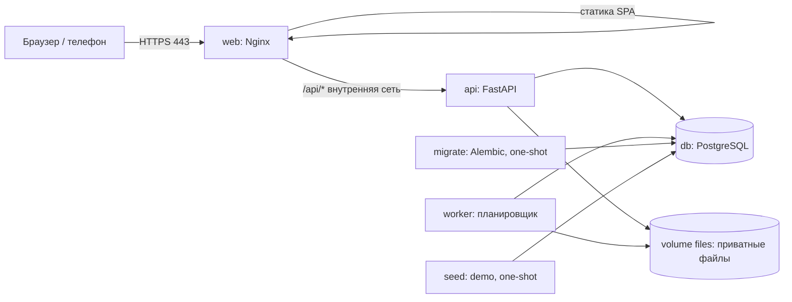

# Разделы 1–4. Описание, стек и архитектура, границы MVP, роли

## 1. Описание проекта

**Qural Hub** — веб-платформа учёта электротехнического оборудования и управления сервисным обслуживанием. Основной объект — **единица оборудования** (трансформатор, подстанция/КТП, распределительное устройство), вокруг которой хранятся паспорт, QR-код, заявки, отчёты, акты и плановые даты обслуживания.

Проект предлагается студенческой командой Университета имени М. Әуезова для **возможного** пилота с Alageum Group. На момент написания ТЗ договорённостей, доступа к реальным данным или согласованных требований компании нет.

### 1.1. Участники и сквозной процесс

| № | Шаг | Актор | Результат в системе |
|---|---|---|---|
| 1 | Открывает своё оборудование, создаёт заявку | Клиент | Заявка `new`, уведомление диспетчерам |
| 2 | Проверяет обращение, подтверждает приоритет, назначает инженера | Диспетчер | `accepted → assigned`, назначение, уведомление инженеру |
| 3 | Сканирует QR на оборудовании, открывает цифровой паспорт и свою заявку | Инженер | Просмотр паспорта и истории |
| 4 | Берёт в работу, диагностика, чек-лист, фото, запчасти | Инженер | `in_progress`, черновик отчёта |
| 5 | При необходимости приостанавливает работу | Инженер/диспетчер | `paused` с причиной и следующим действием |
| 6 | Завершает работы | Инженер | `awaiting_confirmation`, PDF-акт версии N |
| 7 | Подтверждает результат или возвращает на доработку | Клиент | `closed` либо `in_progress` (акт становится неактуальным) |
| 8 | Контролирует сроки, загрузку, историю | Руководитель | Дашборд, аналитика |

### 1.2. Цели MVP (проверяемые)

| Цель | Как проверяется |
|---|---|
| Единая карточка оборудования с историей | Для каждого demo-оборудования паспорт показывает все заявки и акты (тесты E2E-01, IT-15) |
| Полный цикл заявки без бумаги | Сквозной сценарий E2E-01 проходит за один прогон |
| Прозрачность сроков | Значения дашборда совпадают с ожидаемыми для demo (IT-30) |
| Изоляция клиентов | Матричный тест IT-03/IT-04 без единого пропуска |
| Воспроизводимый запуск | Чистая машина + Docker → демо за ≤ 15 минут по README (OP-01) |

### 1.3. Что не заявляется

* Нет утверждений о готовых интеграциях с системами Alageum Group.
* Нет юридической силы подтверждения (это не ЭЦП).
* Нормативные требования (хранение ПДн, сроки хранения актов, требования к охране труда и допускам) **не проверены** и вынесены в список вопросов к компании.

---

## 2. Обязательный стек и архитектура

### 2.1. Стек

| Слой | Технология | Решение / обоснование |
|---|---|---|
| Backend | Python, FastAPI, Pydantic v2 | REST, OpenAPI из кода, валидация схем. Синхронные эндпоинты (`def`), выполняются в threadpool — ДП: проще и безопаснее с ORM, чем смесь async/lazy-loading |
| ORM | SQLAlchemy 2.x (стиль 2.0, `Session`) + драйвер **psycopg 3** | Явные транзакции, `SELECT … FOR UPDATE`, частичные индексы |
| Миграции | Alembic | Единственный способ менять схему; автогенерация проверяется вручную |
| БД | PostgreSQL | UUID, `timestamptz`, `jsonb`, частичные индексы, advisory locks |
| Frontend | React + TypeScript + Vite | SPA; сборка в статические файлы |
| Серверное состояние UI | TanStack Query | Кэш, повтор запросов, инвалидация после мутаций |
| Роутинг UI | React Router | Защищённые маршруты по ролям |
| Формы/валидация UI | react-hook-form + zod | Те же ограничения, что на backend |
| Стили | CSS Modules + CSS-переменные (дизайн-токены) | Без тяжёлых UI-фреймворков, контроль над доступностью |
| QR (генерация) | серверная библиотека QR (кандидат: `segno`) | SVG/PNG/PDF-этикетки |
| QR (сканирование) | кандидат: `qr-scanner` или `html5-qrcode`; основной путь — штатная камера телефона | См. 9.8 |
| PDF | Jinja2 + WeasyPrint (ДП), шрифты Noto Sans/DejaVu встроены в образ | Кириллица, таблицы, повторяемый шаблон. Запасной вариант — ReportLab |
| Изображения | Pillow | Проверка валидности, перекодирование, удаление EXIF (в т.ч. GPS), миниатюры |
| Хэш паролей | argon2-cffi (Argon2id) | |
| Reverse proxy / статика | Nginx | TLS, раздача SPA, прокси `/api`, лимиты |
| Backend-тесты | pytest + HTTPX (`httpx.Client` поверх ASGI/реального URL) | |
| Frontend-тесты | Vitest + React Testing Library | |
| E2E | Playwright | Проекты `desktop-chromium`, `mobile-chromium` (эмуляция телефона) |
| Контейнеры | Docker + Docker Compose (v2, `compose.yaml`) | |
| Качество | Ruff, mypy (backend); ESLint, Prettier, `tsc --noEmit` (frontend) | |

### 2.2. Политика версий (версии не заявляются «последними» без проверки)

В документе **не фиксируются конкретные номера версий как факт**. Ниже — порядок выбора и фиксации; результат записывается в `docs/VERSIONS.md` с датой проверки на этапе 2.

| Шаг | Действие | Проверка |
|---|---|---|
| 1 | Выбрать мажорные линии-кандидаты (таблица ниже) | Страницы релизов/политики поддержки: python.org, postgresql.org/support/versioning, nodejs.org/en/about/previous-releases |
| 2 | Проверить совместимость пар: SQLAlchemy ↔ Alembic ↔ psycopg ↔ PostgreSQL; FastAPI ↔ Pydantic ↔ Starlette; React ↔ React Router ↔ TanStack Query ↔ Testing Library; Vite ↔ Vitest ↔ Node; Playwright (npm) ↔ образ Playwright | Release notes, `pip check`, `npm ls`, запуск тестов |
| 3 | Backend: диапазоны в `pyproject.toml` → **lock-файл с хэшами** | `uv lock` (кандидат) либо `pip-compile --generate-hashes` → `requirements.lock`; образ ставит только из lock (`uv sync --frozen` / `pip install --require-hashes`) |
| 4 | Frontend: точные версии (`save-exact=true` в `.npmrc`), `package-lock.json` | В CI и Dockerfile только `npm ci` |
| 5 | Docker-образы: тег + digest (`image: postgres:<major>-alpine@sha256:…`) | `docker buildx imagetools inspect <image>:<tag>` |
| 6 | Playwright: версия npm-пакета **равна** тегу образа `mcr.microsoft.com/playwright` | Проверка в CI скриптом сравнения |
| 7 | Обновления — еженедельные PR (Dependabot/Renovate), `pip-audit`, `npm audit` в CI | Отчёт CI |

| Компонент | Мажорная линия-кандидат | Критерий выбора |
|---|---|---|
| Python | 3.12 или 3.13 | Поддерживается всеми зависимостями; в образе `python:<ver>-slim` |
| PostgreSQL | 16 или 17 | Статус поддержки на момент старта пилота и ещё ≥ 3 года |
| Node.js | текущая LTS-линия на момент этапа 2 | Только для сборки и тестов, в production-образе не используется |
| FastAPI | 0.x — закрепить точную версию | До 1.0 возможны несовместимые изменения |
| Pydantic | 2.x | |
| SQLAlchemy | 2.x | |
| Alembic | 1.x, совместимый с выбранной SQLAlchemy | |
| React | линия, поддерживаемая Testing Library и TanStack Query | |
| Vite / Vitest | согласованная пара | Vitest должен поддерживать выбранную Vite |
| Nginx | stable-ветка (`nginx:stable-alpine`) | |

### 2.3. Архитектура: модульный монолит

Один backend-процесс (несколько воркеров), одна БД, один сервер. Микросервисы, Kubernetes, брокеры сообщений в MVP не используются.

**Модули backend** (пакеты внутри одного приложения; каждый — `router` → `service` → `repository`, правила домена — только в `service`):

| Модуль | Ответственность |
|---|---|
| `auth` | Вход, сессии, CSRF, пароли, блокировки |
| `users` | Пользователи, роли, деактивация |
| `orgs` | Организации, площадки |
| `equipment` | Реестр, паспорт, QR |
| `tickets` | Заявки, state-machine, SLA-часы, события |
| `assignments` | Назначения, переназначения, нагрузка |
| `execution` | Отчёты, чек-листы, запчасти, исключение по фото |
| `files` | Загрузка, проверка, хранение, выдача |
| `acts` | Генерация PDF, версии, подтверждение |
| `maintenance` | Планы обслуживания, генерация плановых заявок |
| `notifications` | Внутренние уведомления |
| `analytics` | Агрегаты дашборда |
| `audit` | Журнал аудита |
| `common` | Время (`Clock`), ошибки, пагинация, идемпотентность, права (`VisibilityPolicy`) |

**Правила архитектуры (проверяются code review):**

1. Модуль обращается к другому только через его `service` (публичный интерфейс), не через его таблицы и репозитории. Исключение — read-only запросы аналитики.
2. Всё время берётся из `Clock` (режимы: `system`, `fixed`, `shifted`); `datetime.now()` в бизнес-коде запрещён (линтер-правило/тест). Это нужно для воспроизводимого demo и тестов SLA.
3. Фильтрация по организации/назначению делается **только** в одном месте — `VisibilityPolicy` (см. 4.3). Прямые запросы к таблицам из роутеров запрещены.
4. Любая мутация заявки — через единственную функцию `TicketWorkflow.apply(action, …)` (см. раздел 5).
5. Ответы API — Pydantic-схемы; ORM-объекты наружу не отдаются.

### 2.4. Redis, очередь, S3 — не добавляются (обоснование)

| Компонент | Решение | Условие пересмотра (измеримое) |
|---|---|---|
| Redis (кэш, rate-limit, сессии) | Нет. Сессии — в PostgreSQL; rate-limit входа — Nginx + счётчики в БД | p95 запросов дашборда > 1 с при данных пилота после оптимизации индексов |
| Очередь задач (Celery/RQ) | Нет. PDF формируется синхронно (≤ 5 с, лимит 20 с); периодические задачи — контейнер `worker` с планировщиком и advisory-lock | Рост очереди генерации PDF, одновременные > 20 завершений в минуту |
| S3-хранилище | Нет. Приватный Docker volume `files`, выдача **только** через авторизованный API; ключи файлов случайные; бэкап — вместе с БД | Объём файлов > 200 ГБ или > 1 сервера приложения |
| WebSocket/SSE | Нет. Уведомления — опрос раз в 30 с (пауза на скрытой вкладке) | Требование мгновенных уведомлений от компании |

### 2.5. Нефункциональные требования

| Область | Требование (целевое, проверяется тестами) |
|---|---|
| Производительность | p95 для списков ≤ 500 мс при 10 000 заявок и 50 000 событий; дашборд ≤ 1 с; генерация акта ≤ 5 с; загрузка фото 5 МБ по LAN ≤ 3 с |
| Доступность | Один сервер; автоперезапуск контейнеров; восстановление после перезагрузки без ручных шагов |
| Безопасность | OWASP ASVS L1 как ориентир (ДП); Argon2id; HttpOnly+Secure cookie; CSRF; проверка прав на backend; приватные файлы |
| Целостность | Все изменения статуса — в одной транзакции; журналы событий неизменяемы (триггер запрета UPDATE/DELETE) |
| Наблюдаемость | JSON-логи с `request_id`, `/api/v1/health/*`, таблица `job_runs` для задач worker |
| Совместимость | Последние 2 версии Chrome/Edge/Safari/Firefox; Android Chrome и iOS Safari для кабинета инженера |
| Доступность UI | Контраст текста ≥ 4.5:1; управление с клавиатуры; `prefers-reduced-motion` |
| Язык | Русский; все строки в одном месте для будущей локализации (kk/en — вне MVP) |

---

## 3. Границы MVP

| Область | MUST (обязательно) | SHOULD (если хватит времени) | WON'T (не в MVP) |
|---|---|---|---|
| Доступ | Вход по email+паролю, 5 ролей, сессии, отзыв, деактивация, смена пароля | Список активных сессий пользователя | Публичная регистрация, SSO, 2FA, восстановление пароля по почте |
| Данные | Организации, площадки, пользователи, оборудование, паспорт | Вложения (документы) к оборудованию | Импорт из Excel/1С |
| QR | Генерация, печать этикетки, открытие паспорта, ручной поиск | Пакетная печать этикеток PDF, сканер в браузере | Нестандартные метки (NFC, RFID) |
| Заявки | Создание, статусы, назначения, история, комментарии | Дубль-предупреждение при создании | Автоматическая эскалация, внешние каналы (email/SMS/Telegram) |
| Кабинет инженера | Мобильные задания, чек-лист, фото, запчасти, пауза | Автосохранение черновика локально при потере сети | Полностью офлайн-режим (PWA с очередью синхронизации) |
| Запчасти | Справочник и фиксация **использованного** | — | Остатки, закупки, резервирование, склад |
| Документы | PDF-акт, версии, подтверждение/возврат клиентом | «Лист подтверждения» PDF | **Электронная подпись (ЭЦП/КЭП)**, юридически значимый документооборот |
| План | Планы по интервалу, автогенерация заявок, плановые даты | Календарное представление | Сложные графики, привязка к наработке |
| Уведомления | Внутри приложения | — | Email, push, SMS |
| Аналитика | Дашборд руководителя (7 метрик, раздел 10) | Экспорт CSV | BI-конструктор, прогнозирование |
| Эксплуатация | Docker Compose, миграции, seed demo, backup/restore | Автоматическое расписание backup | Kubernetes, HA, горизонтальное масштабирование |
| Интеграции | — | — | ERP, 1С, SCADA, промышленное оборудование, платежи, AI-диагностика, полноценный складской учёт |

**Уточнения:**

* *Учёт запчастей* = фиксация позиций и количества, **использованных** при ремонте (для акта и истории). Остатки, закупки, резервы, цены, поставщики — последующее развитие.
* *Подтверждение акта* = действие авторизованного пользователя клиента с записью `user_id`, времени, версии акта, хэша файла. В интерфейсе и документах оно называется **«подтверждение»**, а не «подпись».

---

## 4. Роли и права доступа

### 4.1. Роли

| Код | Роль | Организация | Назначение | Главные ограничения |
|---|---|---|---|---|
| `admin` | Администратор | Сервисная | Пользователи, справочники, шаблоны, настройки SLA, архивирование | Не ведёт заявки по существу (не назначает, не выполняет, не подтверждает) |
| `dispatcher` | Диспетчер | Сервисная | Приём заявок, приоритет, назначение, пауза/возобновление, отмена, согласование исключения по фото | Не заполняет отчёты, не подтверждает акты за клиента (ДП) |
| `engineer` | Сервисный инженер | Сервисная | Выполнение работ, отчёты, фото, запчасти | Только назначенные заявки + техническая история по ним |
| `manager` | Руководитель | Сервисная | Контроль сроков, загрузки, истории | Только чтение + внутренние комментарии |
| `client` | Клиент | Клиентская | Свои заявки, подтверждение/возврат актов | Только данные своей организации |

Пользователь принадлежит **ровно одной** организации; роль `client` допустима только в организации `kind='client'`, остальные — в `kind='service'`. Проверяется сервисом при создании/изменении и интеграционным тестом; нарушение → `422 VALIDATION_ERROR`.

### 4.2. Матрица прав

Обозначения: **V** просмотр · **C** создание · **U** изменение · **A** назначение · **X** выполнение · **K** подтверждение/возврат · **R** архивирование/деактивация. `—` нет доступа. Пометки: `own` — только своя организация; `asg` — только назначенные заявки (правила в 4.3); `self` — только свои данные.

| Ресурс | admin | dispatcher | engineer | manager | client |
|---|---|---|---|---|---|
| Пользователи | V C U R | V (без служебных полей) | self: V, U (пароль, телефон) | V | self: V, U (пароль, телефон) |
| Организации | V C U R | V | V (по видимым заявкам) | V | V own |
| Площадки | V C U R | V | V (по видимым заявкам) | V | V own |
| Оборудование | V C U R | V C U | V asg | V | V own |
| QR-код (просмотр/печать/перевыпуск) | V U (перевыпуск) | V U | V asg | V | V own (без перевыпуска) |
| Документы оборудования | V C R | V C | V asg | V | V own |
| Планы обслуживания | V C U R | V C U | V asg | V | V own |
| Заявки | V | V C(от имени клиента) U | V asg | V | V own, C, отмена own |
| Назначения | V | V **A** | V self | V | V own (имя инженера) |
| Переходы статусов | — | accept, reject, assign, reassign, pause, resume, cancel, priority | **X**: start, pause, resume, complete | — | **K**: confirm, return; cancel (до начала работ) |
| Отчёт о работах | V | V; решение по исключению фото | V C U **X** asg | V | V (в составе акта) own |
| Чек-лист шаблоны | V C U R | V | V (используемые) | V | — |
| Справочник запчастей | V C U R | V C U | V | V | — |
| Использованные запчасти | V | V | V C U asg (пока черновик) | V | V own (в акте) |
| Вложения заявки | V | V C | V C asg | V | V own (public), C own (до закрытия) |
| Акты | V | V | V asg | V | V own, **K** |
| Комментарии public | V C | V C | V C asg | V | V C own |
| Комментарии internal | V C | V C | V C asg | V C | — |
| Уведомления | self | self | self | self | self |
| Аналитика | V | V (оперативная) | self (своя загрузка) | V | V own (без данных по инженерам) |
| Настройки SLA | V U | V | — | V | — |
| Журнал аудита | V | — | — | — | — |

### 4.3. Область видимости (проверяется на backend для **каждого** эндпоинта)

Единая политика `VisibilityPolicy(user)` возвращает ограничивающее условие для запросов и проверку для отдельного объекта.

| Роль | Видит | Не видит |
|---|---|---|
| `client` | Объекты с `organization_id = user.organization_id`: площадки, оборудование, заявки, public-события, public-комментарии, public-вложения, акты, планы | Чужие организации; internal-комментарии/события; данные других клиентов в поиске, аналитике, файлах, PDF |
| `engineer` | Заявки с **активным назначением** на него (статусы `assigned … awaiting_confirmation`) + завершённые им заявки в `closed` (только чтение). Оборудование и его техническая история (номер, дата, вид, диагноз, выполненные работы, запчасти) — для оборудования, по которому у инженера есть **видимая заявка** | Заявки других инженеров; заявки после переназначения «от» него; оборудование без видимой заявки; организации и пользователей вне контекста его заявок |
| `dispatcher`, `manager`, `admin` | Все данные сервисной и клиентских организаций (в рамках прав 4.2) | — |

**Применение правила:**

* Все списки, поиск (`/search`), аналитика (`/analytics/*`), скачивание файлов (`/attachments/{id}/download`, `/acts/{id}/pdf`), QR-резолвер (`/equipment/by-qr/{code}`) используют `VisibilityPolicy`.
* Объект вне области видимости → `404`. Попытка клиента/инженера обратиться к чужому объекту пишется в `audit_log` (`access_denied`) без раскрытия существования объекта.
* Защита в глубину: составные внешние ключи (`equipment.site_id + organization_id → sites`), тест «обход всех эндпоинтов × ролей × чужих объектов» (IT-03/IT-04), проверка в CI, что в репозиториях нет запросов без политики (маркер/линтер-тест).
* PostgreSQL Row-Level Security **не используется в MVP** (ДП): усложняет пул соединений и миграции; пересмотр — после пилота.

### 4.4. Жизненный цикл пользователя

| Событие | Правило | Кто | Результат |
|---|---|---|---|
| Создание | Публичной регистрации **нет**. Администратор вводит email (уникален без учёта регистра), ФИО, роль, организацию, телефон | `admin` | Система генерирует **временный пароль** (14 символов, криптослучайный), показывает **один раз**; `must_change_password = true`; срок действия `TEMP_PASSWORD_TTL_HOURS` = 72 (ДП). Пароль в БД — только хэш; в логах и аудите значения нет |
| Первый вход | Вход с временным паролем разрешён, но все API кроме `/auth/change-password`, `/auth/me`, `/auth/logout` отвечают `403 PASSWORD_CHANGE_REQUIRED`. UI принудительно ведёт на смену пароля | пользователь | Новый пароль: ≥ 12 символов, не равен email/ФИО, не из списка частых паролей (≥ 1000 записей) |
| Смена пароля | Требует текущий пароль; **отзываются все остальные сессии** | пользователь | `audit_log: password_changed` |
| Сброс пароля | Генерируется новый временный пароль, `must_change_password = true`, все сессии пользователя отзываются | `admin` | `audit_log: password_reset` |
| Блокировка входа | 5 неудачных попыток подряд → `locked_until = now + 15 мин` (ДП); счётчик сбрасывается при успехе; ответ `423 ACCOUNT_LOCKED`. Nginx: ≤ 10 запросов/мин на IP для `/auth/login` | автоматически | `audit_log: login_failed / account_locked` |
| Деактивация | `is_active = false`, `deactivated_at`, **в той же транзакции отзываются все сессии** (`revoked_at`, `revoke_reason='deactivated'`). Нельзя: деактивировать себя; последнего активного `admin` (`409 LAST_ADMIN_PROTECTED`); инженера с активными назначениями (`409 USER_HAS_ACTIVE_ASSIGNMENTS` + список заявок) — сначала переназначить | `admin` | Исторические записи (события, акты) сохраняются и показывают ФИО |
| Реактивация | `is_active = true`, `must_change_password = true`, временный пароль | `admin` | |
| Отзыв сессий | Принудительный выход одного/всех устройств | `admin`; пользователь — свои | `sessions.revoked_at` |
| Удаление | Физическое удаление пользователей не предусмотрено | — | Только деактивация |

### 4.5. Сессии и защита

| Параметр | Значение (ДП, настраивается в `.env`) |
|---|---|
| Механизм | Серверные сессии: случайный 256-битный токен в cookie `ash_session`; в БД — SHA-256 токена |
| Cookie | `HttpOnly; Secure; SameSite=Lax; Path=/` (`Secure` обязателен вне dev) |
| Время жизни | Абсолютное 7 суток, неактивность 24 часа (полевой инженер не должен вводить пароль каждый час) |
| CSRF | Токен возвращается при входе и в `/auth/me`; для POST/PUT/PATCH/DELETE обязателен заголовок `X-CSRF-Token`, иначе `403 CSRF_FAILED` |
| CORS | Отключён (frontend и API на одном origin); в dev — прокси Vite |
| Заголовки | CSP (`default-src 'self'`; `img-src 'self' data: blob:`), `X-Content-Type-Options: nosniff`, `Referrer-Policy: same-origin`, `frame-ancestors 'none'` |
| Проверка на каждый запрос | Сессия не истекла и не отозвана; пользователь `is_active`; организация не архивирована для клиентов |

### 4.6. Критерии приёмки раздела

| № | Критерий | Проверка |
|---|---|---|
| 4-1 | Для каждой ячейки матрицы 4.2 есть автотест «разрешено/запрещено» | IT-01…IT-08 |
| 4-2 | Клиент организации A получает `404` на любой объект организации B, включая PDF и вложения | IT-03, IT-12 |
| 4-3 | После деактивации пользователя его существующая сессия получает `401` при следующем запросе | IT-02 |
| 4-4 | Временный пароль не появляется ни в логах, ни в `audit_log`, ни в повторных ответах API | IT-05 (поиск по логам) |
| 4-5 | Публичного эндпоинта регистрации не существует (в OpenAPI нет) | IT-06 |
