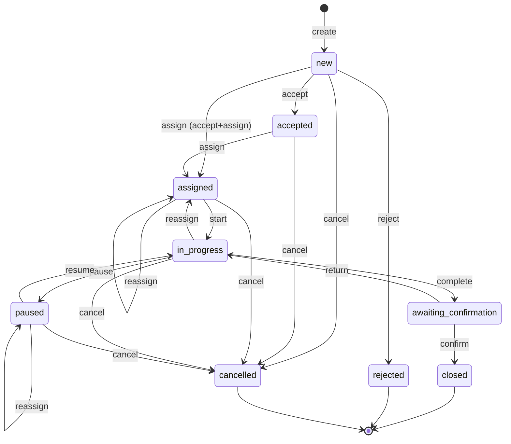

# Раздел 5. Бизнес-процесс заявки

## 5.1. Статусы

| Статус | Тип | Смысл | Часы SLA |
|---|---|---|---|
| `new` | основной | Создана, ждёт реакции диспетчера | идут |
| `accepted` | основной | Принята диспетчером, приоритет подтверждён, инженер не назначен | идут |
| `assigned` | основной | Назначен инженер, работа не начата | идут |
| `in_progress` | основной | Работа выполняется (диагностика и ремонт — этапы **внутри** статуса, см. 5.6) | идут |
| `paused` | дополнительный | Работа приостановлена с причиной и следующим действием | **стоят** |
| `awaiting_confirmation` | основной | Работы завершены, акт сформирован, ждём решения клиента | **стоят** |
| `closed` | терминальный | Клиент подтвердил результат | остановлены |
| `rejected` | терминальный | Диспетчер отклонил обращение | не учитывается |
| `cancelled` | терминальный | Отменена до завершения | не учитывается |

Дополнительно: `tickets.archived_at` — признак архивирования **завершённых** заявок (`closed/rejected/cancelled`), не статус. Архивные заявки скрыты из списков по умолчанию, но доступны по ссылке, в истории оборудования и в аналитике.

## 5.2. Диаграмма состояний

## 5.3. Таблица переходов (полная)

Любой переход, не указанный в таблице, запрещён → `409 INVALID_TRANSITION` (с перечнем допустимых действий в `details.allowed_actions`). Все переходы требуют поле `version` (оптимистичная блокировка, 5.8) и, кроме `reassign`/`priority`, — заголовок `Idempotency-Key`.

| № | Из | В | Действие (endpoint `/tickets/{id}/…`) | Роли | Обязательные поля | Условия / валидация | Побочные действия (в **той же** транзакции) |
|---|---|---|---|---|---|---|---|
| T1 | — | `new` | `POST /tickets` | `client` (оборудование своей организации); `dispatcher` (от имени клиента, `source=phone`); система (`source=scheduler`, `kind=planned`) | `equipment_id`, `title` 5–120, `description` 10–4000, `urgency` | Оборудование не архивировано; организация не архивирована; `urgency→priority`: `planned→normal`, `urgent→high`, `emergency→critical` (для планового — приоритет плана) | Номер `SR-YYYY-NNNN`; снимок SLA-лимитов; `reaction_due_at`; событие `created`; уведомление `ticket_created` диспетчерам; предупреждение `ACTIVE_TICKET_EXISTS`, если по оборудованию есть активная корректирующая заявка (не блокирует) |
| T2 | `new` | `accepted` | `accept` | `dispatcher` | `priority`, `version` | Приоритет указывается явно (подтверждение, даже если не меняется) | `first_reacted_at = now`; пересчёт лимитов при смене приоритета; событие `accepted` (+`priority_changed`, если изменён); уведомление клиенту |
| T3 | `new` | `rejected` | `reject` | `dispatcher` | `reason_code` ∈ {`duplicate`,`not_in_scope`,`insufficient_info`,`other`}, `comment` ≥ 10, `version` | Для `duplicate` можно указать `duplicate_of_ticket_id` | `rejected_at`; событие; уведомление клиенту; часы SLA не считаются |
| T4 | `accepted` | `assigned` | `assign` | `dispatcher` | `engineer_id`, `version`; опц. `scheduled_at`, `comment` | Инженер: `role=engineer`, `is_active`, число активных заявок < `capacity` — **предупреждение**, не запрет (`warnings: ENGINEER_OVERLOADED`) | Новая запись `assignments`; `tickets.assigned_engineer_id`; событие `assigned`; уведомления инженеру и клиенту |
| T4a | `new` | `assigned` | `assign` | `dispatcher` | то же + `priority` | Выполняется как T2 + T4 атомарно; в журнале два события | как T2 + T4 |
| T5 | `assigned`, `in_progress`, `paused` | `assigned` (для `paused` — остаётся `paused`) | `reassign` | `dispatcher` | `engineer_id` (≠ текущего), `reason` ≥ 5, `version` | Новый инженер валиден (как T4). Черновик отчёта остаётся привязан к заявке и переходит новому инженеру | Старое назначение: `ended_at`, `end_reason='reassigned'`; новое назначение; событие `reassigned` (старый → новый, причина; `visibility=internal` для причины); уведомления `ticket_unassigned` старому, `ticket_assigned` новому; из `in_progress` статус → `assigned` (часы SLA продолжают идти) |
| T6 | `assigned` | `in_progress` | `start` | `engineer` (текущий исполнитель) | `version` | Есть активное назначение этого инженера | `started_at` (первый запуск); при первом запуске создаётся черновик отчёта (ревизия 1) с **активным** шаблоном чек-листа для типа оборудования; событие `started`; уведомления клиенту и диспетчерам |
| T7 | `in_progress` | `paused` | `pause` | `engineer` (исполнитель), `dispatcher` | `reason_code` ∈ {`waiting_client`,`waiting_access`,`waiting_parts`,`shutdown_window`,`other`}, `comment` ≥ 10, `next_action` ≥ 10, `expected_resume_at` (> now), `version` | `waiting_parts` — **необязательная** причина, не стадия процесса | Остановка часов SLA (10.2); заполнение `pause_*` полей; событие `paused`; уведомление диспетчерам и клиенту; задание worker: уведомление `pause_overdue`, если `expected_resume_at` прошёл |
| T8 | `paused` | `in_progress` | `resume` | `engineer` (исполнитель), `dispatcher` | `version`; опц. `comment` | — | Запуск часов SLA; очистка `pause_*` (в событии `resumed` сохраняется длительность паузы); уведомление клиенту |
| T9 | `in_progress` | `awaiting_confirmation` | `complete` | `engineer` (исполнитель) | `version`; черновик отчёта проходит проверки 5.5 | Все условия завершения (5.5); успешная генерация PDF | Отчёт: `draft → submitted`, `submitted_at`; акт версии N (`is_current=true`); остановка часов SLA, фиксация `completed_consumed_seconds`, `resolved_within_sla`; `completed_at`; событие `completed` + `act_generated`; уведомления клиенту и диспетчерам |
| T10 | `awaiting_confirmation` | `closed` | `confirm` | `client` (своей организации) | `act_id` (= текущий акт), `version`; опц. `rating` 1–5, `comment` | `act_id` совпадает с `is_current` акта, иначе `409 ACT_OUTDATED` | `acts.decision='confirmed'`, `decided_by/at`, хэш файла фиксируется; `closed_at`; завершение назначения (`end_reason='completed'`); если заявка плановая — обновление плана (`last_done_on`, `next_due_date`); событие `confirmed`; уведомления исполнителю и диспетчерам |
| T11 | `awaiting_confirmation` | `in_progress` | `return` | `client` (своей организации) | `act_id` (= текущий), `comment` ≥ 10, `version` | Как T10 | Акт: `decision='returned'`, `is_current=false`, `superseded_at` — **файл сохраняется**; отчёт ревизии N → `superseded`; новая **черновая** ревизия N+1 (копия: диагноз, работы, ответы чек-листа, запчасти; фото остаются в заявке); `return_count += 1`; запуск часов SLA; событие `returned` (public, с комментарием клиента); уведомления исполнителю и диспетчерам |
| T12 | `new`, `accepted`, `assigned` | `cancelled` | `cancel` | `client` (свои), `dispatcher` | `reason` ≥ 5, `version` | Клиент не может отменять после начала работ | `cancelled_at`; закрытие активного назначения (`end_reason='ticket_cancelled'`); событие `cancelled`; уведомления: диспетчерам (если отменил клиент), исполнителю и клиенту (если отменил диспетчер) |
| T13 | `in_progress`, `paused` | `cancelled` | `cancel` | `dispatcher` | `reason` ≥ 10, `version` | Черновик отчёта и вложения **сохраняются** как история | как T12 |
| T14 | любой активный (`new … paused`) | тот же | `priority` | `dispatcher` | `priority`, `reason` ≥ 5, `version` | Не из `awaiting_confirmation` и терминальных | Пересчёт SLA-лимитов (10.2); событие `priority_changed` |
| T15 | `new … paused` | тот же | `PATCH /tickets/{id}` | `client` (создатель; только в `new`), `dispatcher` (до `awaiting_confirmation`) | изменяемые поля: `title`, `description`, `contact_*`, `scheduled_at`; `version` | В `awaiting_confirmation` и терминальных — `409 TICKET_LOCKED` | Событие `edited` с diff «было/стало» |

**Не предусмотрено в MVP (явно):** подтверждение за клиента диспетчером; «переоткрытие» закрытой заявки (вместо этого создаётся новая заявка со ссылкой `related_ticket_id`); автозакрытие по таймауту (вместо этого напоминание `awaiting_reminder` через 72 ч — ДП).

## 5.4. Дополнительные правила переходов

| Правило | Описание |
|---|---|
| Пауза | Только причина + следующее действие + ожидаемая дата возобновления. Пауза не снимает ответственность инженера: назначение сохраняется. Если `expected_resume_at` прошёл — диспетчер получает `pause_overdue` (один раз на значение даты) |
| Возобновление | Всегда возвращает в `in_progress` (не в `assigned`) |
| Переназначение | Не стирает историю: фиксируется в `assignments` и `ticket_events`. Старый инженер теряет доступ к заявке сразу после коммита |
| Возврат клиентом | Только из `awaiting_confirmation` в `in_progress` с комментарием. Предыдущий акт **сохраняется**, помечается `is_current=false` и в UI подписывается «Неактуален (возвращён клиентом)» |
| Повторное завершение | Создаёт **новый акт** с номером версии N+1 и новой ревизией отчёта; старые акты не изменяются |
| Подтверждение устаревшего акта | Невозможно: `409 ACT_OUTDATED` (клиент открыл страницу до возврата/повторного завершения) |
| Закрытая заявка | Поля заявки, события, отчёт, запчасти, вложения, акты — **неизменяемы**. Допускается только добавление комментариев (public/internal), которые отображаются как комментарии, а не правки. Любой UPDATE закрытой заявки сервисом отвергается (`409 TICKET_LOCKED`); `ticket_events` защищена триггером от UPDATE/DELETE |
| Архивирование | Не меняет статус и данные; ставит `archived_at`. Доступно `admin` для завершённых заявок; обратимо |
| Оборудование/организация в архиве | Не мешают просмотру истории; новые заявки по архивным объектам создать нельзя |

## 5.5. Условия завершения (`complete`)

Переход T9 выполняется, только если **все** проверки пройдены. Иначе `422 COMPLETION_REQUIREMENTS_NOT_MET`, где `details.failed_checks` перечисляет невыполненные пункты (UI подсвечивает каждый).

| № | Проверка | Правило | Код в `failed_checks` |
|---|---|---|---|
| C1 | Диагностика | `diagnosis` ≥ 20 символов | `DIAGNOSIS_MISSING` |
| C2 | Результат работ | `work_performed` ≥ 20 символов; `result_code` ∈ {`resolved`, `resolved_with_remarks`}; `result_summary` ≥ 10; при `resolved_with_remarks` — `recommendations` ≥ 10 | `WORK_RESULT_MISSING` |
| C3 | Чек-лист | Заполнены все пункты `required=true` шаблона привязанной версии; значения проходят валидацию типов и диапазонов; для пункта со значением «не норма» (`flag_if`) обязателен комментарий | `CHECKLIST_INCOMPLETE` (+ список ключей) |
| C4 | Фотографии | ≥ 1 фото со стадией `before` **и** ≥ 1 со стадией `after` в текущей заявке (не удалённые) **ИЛИ** `photo_exception_status = approved` | `PHOTOS_MISSING` |
| C5 | Запчасти | `parts_confirmed = true` (инженер явно подтвердил: список заполнен либо «запчасти не использовались»). Ожидание запчастей **не** требуется | `PARTS_NOT_CONFIRMED` |
| C6 | Исполнитель | Вызывающий — текущий исполнитель; заявка в `in_progress`; в статусе нет незавершённых загрузок | `NOT_ASSIGNEE` / `UPLOAD_IN_PROGRESS` |
| C7 | Акт | PDF сформирован, записан на диск, хэш посчитан; иначе транзакция откатывается | `ACT_GENERATION_FAILED` (HTTP 500) |

**Согласованное исключение по фотографиям:** инженер вызывает `photo-exception` (причина ≥ 20 символов, например «съёмка запрещена правилами площадки») → `photo_exception_status = requested`, диспетчеру уходит уведомление → диспетчер принимает решение (`approved`/`rejected`, комментарий). Решение фиксируется в событиях. После `return` исключение сбрасывается в `none` для новой ревизии (ДП).

## 5.6. Диагностика и ремонт как этапы внутри `in_progress`

Отдельных статусов «диагностика» и «ремонт» нет. Этап выражается заполненностью отчёта:

| Этап | Признак | Что видят пользователи |
|---|---|---|
| Диагностика | `diagnosis` пуст или чек-лист не заполнен | В карточке: «Диагностика» |
| Ремонт | `diagnosis` заполнен, `work_performed` пуст/в работе | «Выполнение работ» |
| Готово к завершению | Проверки C1–C5 проходят | Кнопка «Завершить» активна |

Этап вычисляется на backend (`work_stage`) и отдаётся в ответе заявки; в статусной модели его нет. Ожидание запчастей — только причина паузы `waiting_parts` (необязательная).

## 5.7. Согласованность и транзакции

Алгоритм **каждого** перехода (`TicketWorkflow.apply`):

1. `BEGIN`; `SELECT … FROM tickets WHERE id = :id FOR UPDATE` (строка заявки блокируется — сериализует конкурентные действия над одной заявкой).
2. Проверка области видимости и роли (`VisibilityPolicy`) → `404/403`.
3. Проверка `Idempotency-Key` (5.9) — повтор возвращает сохранённый ответ.
4. Сравнение `version` в запросе с `tickets.version` → `409 VERSION_CONFLICT`, если не совпали.
5. Проверка допустимости перехода по таблице 5.3 (`allowed(from_status, action, role)`) → `409 INVALID_TRANSITION`.
6. Проверка обязательных полей и бизнес-условий (5.5 для `complete`).
7. Изменения: `tickets` (статус, поля, SLA-счётчики, `version = version + 1`), `assignments`, `work_reports`, `acts`, `part_usages` (при необходимости).
8. Вставка `ticket_events` (+ записи `audit_log` для действий с последствиями безопасности).
9. Вставка `notifications` (в той же транзакции — нет потерянных уведомлений).
10. Сохранение записи `idempotency_keys` с ответом.
11. `COMMIT`. При любой ошибке — `ROLLBACK`; файлы, записанные на шаге генерации акта, удаляются в обработчике ошибки (см. 7.9 «Согласованность файлов и БД»).

## 5.8. Одновременная работа: optimistic locking

* `tickets.version` (integer, старт 1) увеличивается при **каждом** изменении. Клиент передаёт `version`, полученный при последнем чтении, в теле запроса.
* Несовпадение → `409 VERSION_CONFLICT`; тело ошибки содержит `details.current_version` и краткое текущее состояние (`status`, `assigned_engineer`, `updated_at`), чтобы UI мог показать «Заявка изменена пользователем … — обновите данные» и предложить повторить действие.
* Таким же образом защищены `work_reports.version` (автосохранение черновика), `users.version`, `organizations.version`, `equipment.version` и т.д.: `PATCH/PUT` требуют `version`.
* **Одновременное назначение:** два диспетчера назначают разных инженеров на одну заявку. Первая транзакция получает блокировку и коммитит (`version` 3→4); вторая после ожидания блокировки видит `version=4` → `409 VERSION_CONFLICT`. Дополнительная страховка — частичный уникальный индекс `assignments(ticket_id) WHERE ended_at IS NULL`.
* **Одновременные действия исполнителя и диспетчера** (например, `complete` и `cancel`): побеждает первый коммит; второй получает `409 VERSION_CONFLICT` либо `409 INVALID_TRANSITION`.

## 5.9. Повторная отправка запроса: `Idempotency-Key`

| Аспект | Правило |
|---|---|
| Где обязателен | `POST /tickets`, все `POST /tickets/{id}/{действие}`, `POST /tickets/{id}/attachments`, `POST /tickets/{id}/comments`, `POST /users`, `POST /users/{id}/reset-password`. Отсутствие → `400 IDEMPOTENCY_KEY_REQUIRED` |
| Формат | UUID v4, генерируется клиентом при открытии формы/нажатии кнопки и **переиспользуется при повторе** |
| Область | `(user_id, key)`; хранится `request_hash = sha256(метод + путь + канонизированное тело)`, статус и тело ответа, срок хранения 24 часа |
| Повтор с тем же ключом и тем же запросом | Возвращается **сохранённый** ответ (тот же код и тело) + заголовок `Idempotent-Replay: true`; действие не выполняется повторно |
| Тот же ключ, другой запрос | `422 IDEMPOTENCY_KEY_REUSED` |
| Тот же ключ, первый запрос ещё выполняется | `409 IDEMPOTENCY_IN_PROGRESS` (клиент повторит через 1–2 с) |
| Отличие от `version` | `Idempotency-Key` защищает от **дубля одного и того же запроса** (двойной клик, повтор при обрыве); `version` защищает от **устаревшего состояния** (два разных пользователя). Нужны оба |
| Дубли без ключа | Невозможны для переходов: после первого успешного повтор получит `409 VERSION_CONFLICT`/`INVALID_TRANSITION` |

## 5.10. Критерии приёмки раздела

| № | Критерий | Тест |
|---|---|---|
| 5-1 | Параметризованный тест «статус × действие × роль» покрывает всю таблицу 5.3; запрещённые комбинации дают `409`/`403` | IT-09, IT-10 |
| 5-2 | Одновременное назначение двух инженеров: ровно один успех, один `409`, в `assignments` одна активная запись | IT-11 |
| 5-3 | Повтор `POST /tickets` с тем же ключом создаёт одну заявку | IT-13 |
| 5-4 | Завершение без фото и без исключения → `422` с `PHOTOS_MISSING` | IT-17 |
| 5-5 | Возврат клиентом сохраняет старый акт (`is_current=false`), повторное завершение создаёт акт версии 2 | IT-20, E2E-02 |
| 5-6 | Подтверждение акта версии 1 после появления версии 2 → `409 ACT_OUTDATED` | IT-21 |
| 5-7 | UPDATE/DELETE по `ticket_events` на уровне БД отклоняется | IT-24 |
