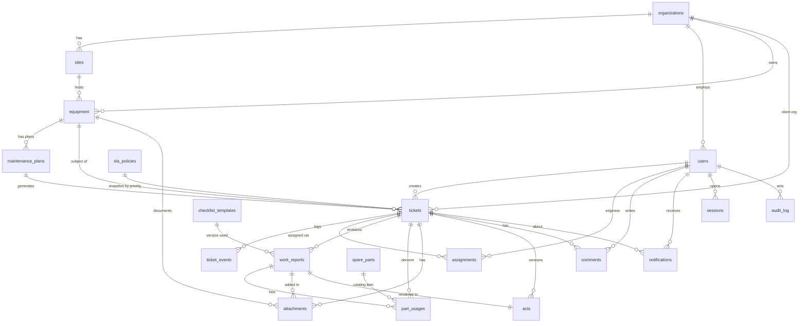

# Раздел 7. База данных (логическая схема PostgreSQL)

## 7.1. Общие соглашения

| Тема | Правило |
|---|---|
| Идентификаторы | `uuid`, `DEFAULT gen_random_uuid()`; для `ticket_events`, `audit_log` — `bigint GENERATED ALWAYS AS IDENTITY` (порядок событий) |
| Время | Все моменты — `timestamptz`, значения хранятся и передаются в UTC. Приложение задаёт `created_at/updated_at` из `Clock`; `DEFAULT now()` — только страховка. «Даты без времени» (`next_due_date`, `commissioned_on`) — `date` в часовом поясе площадки |
| Перечисления | `text` + `CHECK (col IN (…))` (проще менять миграциями, чем `CREATE TYPE`) |
| Строки | `text` с `CHECK (char_length(…) BETWEEN …)` там, где важна граница |
| Регистронезависимая уникальность | Уникальные индексы по `lower(col)` (расширение `citext` не требуется) |
| Оптимистичная блокировка | `version integer NOT NULL DEFAULT 1` у изменяемых сущностей; `UPDATE … SET version = version + 1 WHERE id = :id AND version = :v` |
| Мягкое архивирование | `archived_at timestamptz NULL` (`is_archived` вычисляется); физическое удаление бизнес-данных запрещено (`ON DELETE RESTRICT` везде) |
| Имена | `snake_case`, таблицы во множественном числе |
| Кодировка/сортировка | UTF-8; для поиска — `ILIKE` + триграммные индексы `pg_trgm` (расширение в первой миграции) |
| Расширения | `pgcrypto` (для `gen_random_uuid` на PG < 13 не нужен), `pg_trgm` |

Ниже: **PK** первичный ключ, **FK** внешний ключ (`RESTRICT`, если не указано иное), **UQ** уникальность, **IDX** индекс.

## 7.2. Таблицы

### 7.2.1. `organizations`

| Поле | Тип | NULL | Default | Ограничения |
|---|---|---|---|---|
| `id` | uuid | NO | gen | **PK** |
| `kind` | text | NO | — | CHECK `service`/`client` |
| `name` | text | NO | — | 2–200; **UQ** `lower(name)` |
| `short_name` | text | YES | — | ≤ 60 |
| `bin_iin` | text | YES | — | `^[0-9]{12}$`; **UQ** WHERE NOT NULL |
| `contact_email`, `contact_phone`, `address` | text | YES | — | ≤ 254 / ≤ 20 / ≤ 300 |
| `archived_at` | timestamptz | YES | — | |
| `created_at`, `updated_at` | timestamptz | NO | now() | |
| `version` | integer | NO | 1 | |

IDX: **UQ** `(kind) WHERE kind='service'` (в MVP одна сервисная организация — ДП).

### 7.2.2. `sites`

| Поле | Тип | NULL | Default | Ограничения |
|---|---|---|---|---|
| `id` | uuid | NO | gen | **PK** |
| `organization_id` | uuid | NO | — | **FK** → organizations |
| `name` | text | NO | — | 2–120; **UQ** `(organization_id, lower(name))` |
| `address` | text | NO | — | 5–300 |
| `timezone` | text | NO | `'Asia/Almaty'` | имя IANA (проверка в приложении) |
| `contact_person`, `contact_phone` | text | YES | — | |
| `archived_at`, `created_at`, `updated_at`, `version` | | | | как выше |

Доп.: **UQ** `(id, organization_id)` — основа составных FK.

### 7.2.3. `users`

| Поле | Тип | NULL | Default | Ограничения |
|---|---|---|---|---|
| `id` | uuid | NO | gen | **PK** |
| `organization_id` | uuid | NO | — | **FK** → organizations |
| `email` | text | NO | — | ≤ 254; **UQ** `lower(email)` |
| `full_name` | text | NO | — | 2–120 |
| `phone` | text | YES | — | |
| `role` | text | NO | — | CHECK 5 ролей |
| `password_hash` | text | NO | — | Argon2id |
| `must_change_password` | boolean | NO | true | |
| `temp_password_expires_at` | timestamptz | YES | — | |
| `is_active` | boolean | NO | true | |
| `failed_login_count` | integer | NO | 0 | |
| `locked_until` | timestamptz | YES | — | |
| `last_login_at` | timestamptz | YES | — | |
| `capacity` | smallint | NO | 4 | 1–20 (значимо для `engineer`) |
| `deactivated_at` | timestamptz | YES | — | |
| `created_by` | uuid | YES | — | **FK** → users |
| `created_at`, `updated_at`, `version` | | | | |

IDX: `(organization_id, role)`; `(role) WHERE is_active`. Соответствие роли и вида организации — проверка в сервисе и контрольный запрос в тесте (триггер не используется — ДП).

### 7.2.4. `sessions`

| Поле | Тип | NULL | Default | Ограничения |
|---|---|---|---|---|
| `id` | uuid | NO | gen | **PK** |
| `user_id` | uuid | NO | — | **FK** → users |
| `token_hash` | bytea | NO | — | SHA-256, **UQ** |
| `csrf_token_hash` | bytea | NO | — | |
| `created_at`, `last_seen_at` | timestamptz | NO | now() | |
| `idle_expires_at`, `expires_at` | timestamptz | NO | — | скользящий/абсолютный сроки |
| `revoked_at` | timestamptz | YES | — | |
| `revoke_reason` | text | YES | — | `logout`/`password_changed`/`deactivated`/`admin`/`expired` |
| `ip` | inet | YES | — | |
| `user_agent` | text | YES | — | ≤ 300 |

IDX: `(user_id) WHERE revoked_at IS NULL`; `(expires_at)` для очистки worker. `last_seen_at` обновляется не чаще раза в минуту.

### 7.2.5. `equipment`

| Поле | Тип | NULL | Default | Ограничения |
|---|---|---|---|---|
| `id` | uuid | NO | gen | **PK** |
| `organization_id` | uuid | NO | — | **FK** → organizations |
| `site_id` | uuid | NO | — | **составной FK** `(site_id, organization_id)` → sites(id, organization_id) |
| `type` | text | NO | — | CHECK `transformer`/`substation`/`switchgear` |
| `inventory_number` | text | NO | — | 1–50; **UQ** `(organization_id, inventory_number)` |
| `name` | text | NO | — | 2–150 |
| `manufacturer`, `model`, `serial_number` | text | YES | — | ≤ 100; **UQ** `(lower(manufacturer), lower(serial_number)) WHERE both NOT NULL` |
| `manufacture_year` | smallint | YES | — | 1950–2100 |
| `commissioned_on` | date | YES | — | |
| `voltage_class_kv` | numeric(7,2) | YES | — | > 0 |
| `rated_power_kva` | numeric(10,2) | YES | — | > 0 |
| `technical_state` | text | NO | `'operational'` | `operational`/`degraded`/`out_of_service` |
| `location_description` | text | YES | — | ≤ 300 |
| `passport_data` | jsonb | NO | `'{}'` | схема по типу |
| `qr_code` | text | NO | — | `^[A-Z0-9]{12}$`, **UQ** |
| `qr_rotated_at` | timestamptz | YES | — | |
| `notes` | text | YES | — | ≤ 2000 |
| `archived_at`, `created_at`, `updated_at`, `version` | | | | |

IDX: `(organization_id, site_id)`; `(type)`; триграммные GIN по `name`, `inventory_number`, `serial_number` (поиск); **UQ** `(id, organization_id)` для составных FK из `tickets`, `maintenance_plans`.

### 7.2.6. `maintenance_plans`

| Поле | Тип | NULL | Default | Ограничения |
|---|---|---|---|---|
| `id` | uuid | NO | gen | **PK** |
| `equipment_id` | uuid | NO | — | **FK** → equipment |
| `title` | text | NO | — | 3–150 |
| `description` | text | YES | — | ≤ 1000 |
| `interval_days` | integer | NO | — | 1–1825 |
| `lead_days` | integer | NO | 7 | 0–60 |
| `priority` | text | NO | `'low'` | `low`/`normal`/`high`/`critical` |
| `checklist_code` | text | YES | — | код шаблона; NULL → активный шаблон типа |
| `last_done_on` | date | YES | — | |
| `next_due_date` | date | NO | — | |
| `is_active` | boolean | NO | true | |
| `created_by` | uuid | NO | — | **FK** → users |
| `created_at`, `updated_at`, `version` | | | | |

IDX: `(is_active, next_due_date)`; `(equipment_id)`.

### 7.2.7. `tickets`

| Поле | Тип | NULL | Default | Ограничения |
|---|---|---|---|---|
| `id` | uuid | NO | gen | **PK** |
| `number` | text | NO | — | `SR-YYYY-NNNN`, **UQ** |
| `organization_id` | uuid | NO | — | клиентская организация (копия из оборудования) |
| `equipment_id` | uuid | NO | — | **составной FK** `(equipment_id, organization_id)` → equipment(id, organization_id) |
| `site_id` | uuid | NO | — | копия площадки оборудования (для фильтров); **составной FK** `(site_id, organization_id)` → sites |
| `kind` | text | NO | `'corrective'` | `corrective`/`planned` |
| `source` | text | NO | `'web'` | `web`/`phone`/`scheduler` |
| `plan_id` | uuid | YES | — | **FK** → maintenance_plans |
| `plan_due_date` | date | YES | — | **UQ** `(plan_id, plan_due_date) WHERE plan_id IS NOT NULL`; CHECK `(plan_id IS NULL) = (plan_due_date IS NULL)` |
| `title` | text | NO | — | 5–120 |
| `description` | text | NO | — | 10–4000 |
| `urgency` | text | NO | `'planned'` | `planned`/`urgent`/`emergency` (заявлено клиентом) |
| `priority` | text | NO | `'normal'` | `low`/`normal`/`high`/`critical` |
| `status` | text | NO | `'new'` | 9 статусов |
| `created_by` | uuid | YES | — | **FK** → users; NULL — система (`scheduler`) |
| `contact_name`, `contact_phone` | text | YES | — | |
| `related_ticket_id` | uuid | YES | — | **FK** → tickets (self) |
| `assigned_engineer_id` | uuid | YES | — | **FK** → users; дублирует активное назначение (поддерживается в транзакции) |
| `scheduled_at` | timestamptz | YES | — | плановый визит |
| **SLA** | | | | |
| `sla_reaction_limit_seconds` | integer | NO | — | снимок политики |
| `sla_resolution_limit_seconds` | integer | NO | — | снимок политики; пересчитывается при смене приоритета |
| `reaction_due_at` | timestamptz | NO | — | `created_at + reaction_limit` (пока нет реакции) |
| `first_reacted_at` | timestamptz | YES | — | момент `accepted` |
| `sla_consumed_seconds` | integer | NO | 0 | накопленные «рабочие» секунды без текущего отрезка |
| `sla_clock_started_at` | timestamptz | YES | — | NOT NULL ⇔ статус ∈ {`new`,`accepted`,`assigned`,`in_progress`} |
| `sla_due_at` | timestamptz | YES | — | `clock_started_at + (limit − consumed)` при идущих часах |
| `completed_consumed_seconds` | integer | YES | — | значение часов на момент **последнего** завершения |
| `resolved_within_sla` | boolean | YES | — | `completed_consumed_seconds ≤ limit` |
| **Пауза (текущая)** | | | | |
| `pause_reason_code`, `pause_comment`, `pause_next_action` | text | YES | — | заполнены ⇔ `status='paused'` |
| `pause_expected_resume_at` | timestamptz | YES | — | |
| **Жизненный цикл** | | | | |
| `accepted_at`, `started_at`, `completed_at`, `closed_at`, `rejected_at`, `cancelled_at` | timestamptz | YES | — | денормализованные отметки (истина — `ticket_events`) |
| `return_count` | integer | NO | 0 | |
| `archived_at` | timestamptz | YES | — | только для терминальных статусов |
| `created_at`, `updated_at` | timestamptz | NO | now() | |
| `version` | integer | NO | 1 | |

**CHECK-инварианты:**

* `status='paused'` ⇔ все четыре `pause_*` NOT NULL.
* `status IN ('assigned','in_progress','paused','awaiting_confirmation')` ⇒ `assigned_engineer_id IS NOT NULL`.
* `sla_clock_started_at IS NOT NULL` ⇔ `status IN ('new','accepted','assigned','in_progress')`.
* `status='closed'` ⇒ `closed_at IS NOT NULL`; `rejected` ⇒ `rejected_at`; `cancelled` ⇒ `cancelled_at`.
* `archived_at IS NOT NULL` ⇒ `status IN ('closed','rejected','cancelled')`.

**Триггер `tickets_terminal_guard`:** при `OLD.status IN ('closed','rejected','cancelled')` запрещает UPDATE любых полей, кроме `archived_at`, `updated_at`, `version`.

**Индексы:** `(status)`; `(organization_id, status, created_at DESC)`; `(assigned_engineer_id, status)`; `(equipment_id, created_at DESC)`; `(priority, status)`; `(created_at DESC)`; частичный `(sla_due_at) WHERE status IN ('new','accepted','assigned','in_progress')` (просрочки); частичный `(reaction_due_at) WHERE status='new'`; GIN-триграммы по `title`; **UQ** `number`.

### 7.2.8. `ticket_events` (неизменяемый журнал)

| Поле | Тип | NULL | Default | Ограничения |
|---|---|---|---|---|
| `id` | bigint | NO | identity | **PK** |
| `ticket_id` | uuid | NO | — | **FK** → tickets |
| `event_type` | text | NO | — | перечень 6.11 |
| `visibility` | text | NO | `'public'` | `public`/`internal` |
| `actor_user_id` | uuid | YES | — | **FK** → users; NULL — система |
| `actor_role` | text | YES | — | снимок роли |
| `from_status`, `to_status` | text | YES | — | |
| `comment` | text | YES | — | ≤ 4000 |
| `payload` | jsonb | NO | `'{}'` | |
| `request_id` | uuid | YES | — | корреляция с логами |
| `created_at` | timestamptz | NO | now() | |

IDX: `(ticket_id, id)`; `(event_type, created_at)`. **Триггер** `BEFORE UPDATE OR DELETE` → `RAISE EXCEPTION`. `TRUNCATE` отозван у прикладной роли.

### 7.2.9. `assignments`

| Поле | Тип | NULL | Default | Ограничения |
|---|---|---|---|---|
| `id` | uuid | NO | gen | **PK** |
| `ticket_id` | uuid | NO | — | **FK** → tickets |
| `engineer_id` | uuid | NO | — | **FK** → users |
| `assigned_by` | uuid | NO | — | **FK** → users |
| `assigned_at` | timestamptz | NO | now() | |
| `scheduled_at` | timestamptz | YES | — | |
| `comment` | text | YES | — | ≤ 500 |
| `ended_at` | timestamptz | YES | — | |
| `end_reason` | text | YES | — | `reassigned`/`completed`/`ticket_cancelled`; NOT NULL ⇔ `ended_at` NOT NULL |

IDX: **UQ** `(ticket_id) WHERE ended_at IS NULL` (одна активная); `(engineer_id) WHERE ended_at IS NULL`; `(engineer_id, ticket_id)`.

### 7.2.10. `checklist_templates`

| Поле | Тип | NULL | Default | Ограничения |
|---|---|---|---|---|
| `id` | uuid | NO | gen | **PK** |
| `code` | text | NO | — | `^[a-z0-9_]{3,40}$` |
| `version` | integer | NO | 1 | **UQ** `(code, version)` |
| `equipment_type` | text | NO | — | тип оборудования |
| `title` | text | NO | — | 3–150 |
| `schema` | jsonb | NO | — | `{"items":[…]}` по 6.7 |
| `status` | text | NO | `'draft'` | `draft`/`active`/`retired` |
| `created_by` | uuid | NO | — | **FK** → users |
| `created_at`, `published_at`, `retired_at` | timestamptz | | | |

IDX: **UQ** `(equipment_type) WHERE status='active'` (один активный шаблон на тип — ДП); **триггер**: при `OLD.status <> 'draft'` менять `schema/title/code/version/equipment_type` нельзя.

### 7.2.11. `work_reports`

| Поле | Тип | NULL | Default | Ограничения |
|---|---|---|---|---|
| `id` | uuid | NO | gen | **PK** |
| `ticket_id` | uuid | NO | — | **FK** → tickets |
| `revision` | integer | NO | 1 | **UQ** `(ticket_id, revision)` |
| `status` | text | NO | `'draft'` | `draft`/`submitted`/`superseded` |
| `author_id` | uuid | NO | — | **FK** → users (инженер ревизии) |
| `checklist_template_id` | uuid | NO | — | **FK** → checklist_templates (версия) |
| `checklist_answers` | jsonb | NO | `'{}'` | |
| `diagnosis`, `work_performed`, `result_summary`, `recommendations` | text | YES | — | пределы 6.7 |
| `result_code` | text | YES | — | `resolved`/`resolved_with_remarks` |
| `labor_minutes` | integer | YES | — | 0–10000 |
| `parts_confirmed` | boolean | NO | false | |
| `photo_exception_status` | text | NO | `'none'` | `none`/`requested`/`approved`/`rejected` |
| `photo_exception_reason` | text | YES | — | ≥ 20 при статусе ≠ `none` |
| `photo_exception_decided_by` | uuid | YES | — | **FK** → users |
| `photo_exception_decided_at`, `photo_exception_comment` | | YES | | |
| `submitted_at` | timestamptz | YES | — | |
| `created_at`, `updated_at` | timestamptz | NO | now() | |
| `version` | integer | NO | 1 | |

IDX: **UQ** `(ticket_id) WHERE status='draft'`; `(ticket_id, revision DESC)`. Автор ревизии обновляется на нового исполнителя при переназначении (черновик).

### 7.2.12. `spare_parts`

| Поле | Тип | NULL | Default | Ограничения |
|---|---|---|---|---|
| `id` | uuid | NO | gen | **PK** |
| `sku` | text | NO | — | 1–40; **UQ** `lower(sku)` |
| `name` | text | NO | — | 2–150 |
| `unit` | text | NO | — | `pcs`/`l`/`kg`/`m`/`set` |
| `category` | text | YES | — | ≤ 60 |
| `description` | text | YES | — | ≤ 500 |
| `is_active` | boolean | NO | true | |
| `created_at`, `updated_at`, `version` | | | | |

Остатков, цен, поставщиков в таблице **нет** (вне MVP).

### 7.2.13. `part_usages`

| Поле | Тип | NULL | Default | Ограничения |
|---|---|---|---|---|
| `id` | uuid | NO | gen | **PK** |
| `ticket_id` | uuid | NO | — | **FK** → tickets |
| `work_report_id` | uuid | NO | — | **FK** → work_reports |
| `spare_part_id` | uuid | NO | — | **FK** → spare_parts |
| `quantity` | numeric(12,3) | NO | — | > 0 |
| `unit_snapshot` | text | NO | — | копия единицы |
| `serial_or_batch` | text | YES | — | ≤ 80 |
| `comment` | text | YES | — | ≤ 300 |
| `added_by` | uuid | NO | — | **FK** → users |
| `created_at`, `updated_at` | timestamptz | NO | now() | |

IDX: **UQ** `(work_report_id, spare_part_id)`; `(ticket_id)`; `(spare_part_id)`. Изменение/удаление допустимо, только если отчёт `draft` (проверка в сервисе + триггер на `work_reports.status`).

### 7.2.14. `attachments`

| Поле | Тип | NULL | Default | Ограничения |
|---|---|---|---|---|
| `id` | uuid | NO | gen | **PK** |
| `ticket_id` | uuid | YES | — | **FK** → tickets |
| `equipment_id` | uuid | YES | — | **FK** → equipment |
| `work_report_id` | uuid | YES | — | **FK** → work_reports (ревизия, в которой добавлено) |
| `kind` | text | NO | — | `photo`/`document` |
| `stage` | text | YES | — | `before`/`during`/`after`/`other`; NOT NULL для фото заявки |
| `visibility` | text | NO | `'public'` | `public`/`internal` |
| `original_filename` | text | NO | — | ≤ 200, очищено |
| `content_type` | text | NO | — | определён по содержимому |
| `size_bytes` | bigint | NO | — | > 0 |
| `sha256` | char(64) | NO | — | |
| `width`, `height` | integer | YES | — | для фото |
| `storage_key` | text | NO | — | **UQ**; относительный путь на томе |
| `thumb_storage_key` | text | YES | — | |
| `uploaded_by` | uuid | NO | — | **FK** → users |
| `uploaded_at` | timestamptz | NO | now() | |
| `deleted_at` | timestamptz | YES | — | мягкое удаление |

CHECK: `num_nonnulls(ticket_id, equipment_id) = 1`. IDX: `(ticket_id) WHERE deleted_at IS NULL`; `(equipment_id) WHERE deleted_at IS NULL`; `(sha256)`.

### 7.2.15. `acts`

| Поле | Тип | NULL | Default | Ограничения |
|---|---|---|---|---|
| `id` | uuid | NO | gen | **PK** |
| `ticket_id` | uuid | NO | — | **FK** → tickets |
| `work_report_id` | uuid | NO | — | **FK** → work_reports, **UQ** |
| `version` | integer | NO | — | **UQ** `(ticket_id, version)`; совпадает с `revision` отчёта |
| `number` | text | NO | — | `{ticket.number}-A{version}`, **UQ** |
| `is_current` | boolean | NO | true | **UQ** `(ticket_id) WHERE is_current` |
| `superseded_at` | timestamptz | YES | — | |
| `layout_version` | text | NO | `'act_v1'` | версия макета PDF |
| `data_snapshot` | jsonb | NO | — | данные, из которых отрисован PDF |
| `storage_key` | text | NO | — | **UQ** |
| `size_bytes` | bigint | NO | — | |
| `sha256` | char(64) | NO | — | хэш PDF |
| `generated_by` | uuid | NO | — | **FK** → users |
| `generated_at` | timestamptz | NO | now() | |
| `decision` | text | YES | — | `confirmed`/`returned` |
| `decided_by` | uuid | YES | — | **FK** → users |
| `decided_at` | timestamptz | YES | — | |
| `decision_comment` | text | YES | — | ≤ 2000; ≥ 10 при `returned` |
| `rating` | smallint | YES | — | 1–5 |

**Триггер:** после вставки менять можно только `is_current`, `superseded_at`, `decision*`, `decided_*`, `rating`; `decision` ставится один раз. Строки акта не удаляются.

### 7.2.16. `comments`

| Поле | Тип | NULL | Default | Ограничения |
|---|---|---|---|---|
| `id` | uuid | NO | gen | **PK** |
| `ticket_id` | uuid | NO | — | **FK** → tickets |
| `author_id` | uuid | NO | — | **FK** → users |
| `body` | text | NO | — | 1–4000 |
| `visibility` | text | NO | `'public'` | `public`/`internal` |
| `created_at` | timestamptz | NO | now() | |

IDX: `(ticket_id, created_at)`. UPDATE/DELETE запрещены триггером.

### 7.2.17. `notifications`

| Поле | Тип | NULL | Default | Ограничения |
|---|---|---|---|---|
| `id` | uuid | NO | gen | **PK** |
| `user_id` | uuid | NO | — | **FK** → users |
| `type` | text | NO | — | перечень 6.13 |
| `title` | text | NO | — | ≤ 120 |
| `body` | text | YES | — | ≤ 500 |
| `ticket_id` | uuid | YES | — | **FK** → tickets |
| `payload` | jsonb | NO | `'{}'` | |
| `dedupe_key` | text | YES | — | **UQ** `(user_id, dedupe_key) WHERE dedupe_key IS NOT NULL` |
| `created_at` | timestamptz | NO | now() | |
| `read_at` | timestamptz | YES | — | |

IDX: `(user_id, created_at DESC)`; `(user_id) WHERE read_at IS NULL`.

### 7.2.18. `audit_log`

| Поле | Тип | NULL | Default | Ограничения |
|---|---|---|---|---|
| `id` | bigint | NO | identity | **PK** |
| `occurred_at` | timestamptz | NO | now() | |
| `actor_user_id` | uuid | YES | — | **FK** → users; NULL — аноним/система |
| `actor_role` | text | YES | — | |
| `action` | text | NO | — | `login_success`, `login_failed`, `account_locked`, `logout`, `password_changed`, `password_reset`, `user_created`, `user_updated`, `user_deactivated`, `user_activated`, `sessions_revoked`, `qr_rotated`, `entity_archived`, `entity_unarchived`, `template_published`, `sla_policy_changed`, `access_denied`, `act_downloaded`, `file_downloaded` и т.п. |
| `object_type`, `object_id` | text | YES | — | |
| `ip` | inet | YES | — | |
| `user_agent` | text | YES | — | |
| `request_id` | uuid | YES | — | |
| `details` | jsonb | NO | `'{}'` | **без секретов** (пароли, токены, хэши не записываются) |

IDX: `(occurred_at DESC)`; `(actor_user_id, occurred_at)`; `(action, occurred_at)`. Триггер запрета UPDATE/DELETE.

### 7.2.19. Дополнительные таблицы (с обоснованием)

| Таблица | Зачем нужна | Поля (кратко) |
|---|---|---|
| `sla_policies` | Сроки по приоритетам — настраиваемые, а не зашитые в код (раздел 10) | `priority` PK, `reaction_minutes`, `resolution_minutes`, `updated_by`, `updated_at`, `version` |
| `number_counters` | Непрерывная нумерация заявок `SR-YYYY-NNNN` без гонок | `year` smallint PK, `last_value` integer; `UPDATE … SET last_value = last_value + 1 RETURNING` в транзакции создания |
| `idempotency_keys` | Защита от дублей запросов (5.9) | `user_id`, `key` (uuid) — **PK** `(user_id, key)`; `request_hash`, `state` (`in_progress`/`done`), `response_status`, `response_body` jsonb, `created_at`, `expires_at`; IDX `(expires_at)` |
| `job_runs` | Наблюдаемость фоновых задач и защита от параллельных запусков | `id`, `job_name`, `started_at`, `finished_at`, `status` (`running`/`ok`/`failed`), `details` jsonb |
| `app_meta` | Маркеры развёртывания: режим (`deployment_mode` = `dev`/`demo`/`pilot`), версия demo-seed, дата инициализации. **Запрещает demo-seed в пилоте** | `key` PK, `value`, `updated_at` |

## 7.3. ER-диаграмма

## 7.4. Связи и ключевые правила

| Связь | Кратность | Правило |
|---|---|---|
| organization → users | 1:N | Клиентские пользователи — только в `kind=client` |
| organization → sites → equipment | 1:N:N | Составной FK исключает оборудование на чужой площадке |
| equipment → tickets | 1:N | `tickets.organization_id` = организация оборудования (составной FK) |
| ticket → assignments | 1:N, активное ≤ 1 | Частичный UQ |
| ticket → work_reports | 1:N | Не более одного `draft`; `revision` растёт |
| work_report → act | 1:0..1 | Акт создаётся при `submitted` |
| ticket → acts | 1:N | Один `is_current` |
| ticket → ticket_events | 1:N | Только INSERT |
| plan → tickets | 1:N | `(plan_id, plan_due_date)` уникально |

## 7.5. Изоляция клиентских данных

1. **Слой приложения (основной):** `VisibilityPolicy` добавляет `organization_id = :org` ко всем запросам клиента; для инженера — `EXISTS` по активному/завершённому назначению.
2. **Слой схемы:** составные внешние ключи; `tickets.organization_id` обязательно; вложения/акты/комментарии доступны только через заявку или оборудование, поэтому проверка идёт по владельцу объекта.
3. **Слой тестов:** автоматический обход всех маршрутов × роли × «чужие» идентификаторы (IT-03, IT-04, IT-12).
4. **RLS PostgreSQL:** не применяется в MVP (ДП); при росте числа клиентов — кандидат на внедрение (`SET LOCAL app.org_id`).
5. **Сеть и роли БД:** БД не публикуется наружу; приложение использует роль `app_rw` без прав `SUPERUSER/BYPASSRLS/DDL`; миграции выполняются ролью `app_migrator`.

## 7.6. Хранение времени в UTC

* Все `timestamptz` пишутся из `Clock.now()` в UTC (`datetime` с `tzinfo=UTC`); API отдаёт ISO 8601 с `Z`.
* Часовой пояс площадки используется только для отображения и для определения календарной даты (`next_due_date`, «сегодня» для планов).
* Перевод летнего времени не затрагивает хранение; тесты SLA используют только UTC-арифметику.
* Сессия БД: `SET TIME ZONE 'UTC'` при подключении.

## 7.7. Версионирование чек-листов и актов

| Объект | Механизм |
|---|---|
| Шаблон чек-листа | Строка = `(code, version)`; публикация делает версию `active` и переводит прежнюю активную того же типа в `retired`; опубликованное не редактируется. Заявка привязывается к версии при создании черновика отчёта (`work_reports.checklist_template_id`) |
| Отчёт | Ревизии 1…N; отправленная ревизия иммутабельна; возврат клиентом создаёт ревизию N+1 как копию |
| Акт | `version` = `revision`; `data_snapshot` + `layout_version` позволяют воспроизвести документ; PDF и хэш не меняются |
| Политика SLA | Значения копируются в `tickets.sla_*_limit_seconds` при создании; изменение политики не влияет на уже созданные заявки (ДП), если администратор не выполнит пересчёт отдельной командой |

## 7.8. Сохранение истории после архивирования

* Архивирование = `archived_at` (организации, площадки, оборудование, заявки, пользователи через `is_active`, справочник запчастей через `is_active`, шаблоны через `retired`).
* Внешние ключи `RESTRICT` — запись нельзя физически удалить, пока на неё ссылаются история, события, акты.
* Снимки в записях (`unit_snapshot`, `actor_role`, `data_snapshot`) сохраняют смысл истории при изменении справочников.
* ФИО пользователей в истории берутся из `users` (деактивированные остаются). Анонимизация по запросу субъекта ПДн — вопрос к компании (раздел 14).

## 7.9. Согласованность файлов и записей БД

Файловая система не участвует в транзакциях PostgreSQL, поэтому применяется порядок «сначала файл — потом запись — потом очистка».

| Операция | Порядок | При сбое |
|---|---|---|
| Загрузка вложения | 1) Получить поток, проверить тип/размер/содержимое, сформировать итоговый файл и миниатюру → записать в `tmp/{uuid}` → `fsync` → переименовать в `attachments/{yyyy}/{mm}/{uuid}.{ext}`; 2) в транзакции вставить `attachments` + `ticket_events`; 3) `COMMIT` | Сбой до коммита: обработчик удаляет файл; если процесс упал — файл становится «сиротой», его удаляет worker (файлы старше 24 ч, на которые нет ссылки). Запись без файла невозможна, так как запись создаётся после файла |
| Формирование акта | 1) PDF в память; 2) запись в `tmp/{uuid}` → `fsync` → атомарный `rename` в **финальный** путь `acts/{yyyy}/{mm}/{uuid}.pdf` (случайный ключ, `tmp` и финальный каталог на одном томе); 3) транзакция (статус, отчёт, акт со `storage_key`, события, уведомления); 4) `COMMIT` | Сбой/откат на шаге 3: обработчик удаляет финальный файл; при падении процесса файл остаётся «сиротой» (в БД на него нет ссылки) и удаляется worker через 24 ч. Состояния «запись акта есть, файла нет» при штатной работе не возникает, так как файл записывается раньше записи |
| Мягкое удаление | Только `deleted_at`; физическое удаление файлов worker выполняет через 30 дней (ДП) | |
| Сверка | Команда `python -m app.cli verify-storage` (и ночная задача worker): сравнивает записи `attachments/acts` с файлами и хэшами; отчёт в `job_runs.details` и лог уровня WARNING | |
| Backup | Файлы и БД копируются в один «снимок» (раздел 11.9); при восстановлении запускается `verify-storage` | |

## 7.10. Транзакции при изменении статуса

Описаны алгоритмом 5.7: блокировка строки заявки `FOR UPDATE`, проверка `version`, изменения, события, уведомления, идемпотентность — **в одной транзакции** уровня `READ COMMITTED` (достаточно благодаря явной блокировке). Для `number_counters` применяется атомарный `UPDATE … RETURNING`. Взаимные блокировки исключаются порядком захвата: `tickets` → `assignments` → `work_reports` → `acts`.

## 7.11. Миграции и первоначальное заполнение

| Правило | Описание |
|---|---|
| Инструмент | Alembic; каждая миграция — отдельный файл с понятным именем; `alembic check` в CI проверяет, что модели и миграции совпадают |
| Порядок первой цепочки | `0001_extensions_and_meta` (pg_trgm, `app_meta`, `job_runs`) → `0002_core_identity` (organizations, sites, users, sessions, `audit_log` + триггер, `idempotency_keys`, `sla_policies`) → `0003_equipment_plans` → `0004_tickets_core` (tickets, `number_counters`, `ticket_events`, assignments, comments, notifications + триггеры) → `0005_execution` (templates, reports, parts, usages) → `0006_files_acts` (attachments, acts) → `0007_indexes_search` (триграммные индексы и индексы аналитики по итогам профилирования) |
| Совместимость | Политика expand/contract: добавляем столбец/таблицу → выкатываем код → удаляем старое отдельной миграцией. Откат приложения на предыдущую версию без отката схемы должен работать для двух последних миграций |
| Откат схемы | `downgrade` пишется для структурных миграций и проверяется в CI на пустой БД; **данные** откатываются только восстановлением из backup |
| Запуск | Контейнер `migrate` (one-shot) до старта `api`/`worker` (раздел 11) |
| Первичные данные (всегда) | Одна сервисная организация (создаётся командой инициализации), `sla_policies` (4 строки по умолчанию), активные шаблоны чек-листов для трёх типов, базовый справочник единиц; `app_meta.deployment_mode` |
| Администратор | Команда `python -m app.cli create-admin` (пароль запрашивается интерактивно или из `--password-file`), без пароля в истории оболочки |
| Demo | Отдельная команда `seed-demo` (раздел 12) и только при `deployment_mode ≠ pilot`; идемпотентна |
| Права БД | Миграции — роль `app_migrator` (DDL); приложение — `app_rw` (DML, без DDL, без `TRUNCATE` на `ticket_events`, `audit_log`) |

## 7.12. Критерии приёмки раздела

| № | Критерий | Тест |
|---|---|---|
| 7-1 | `alembic upgrade head` на пустой БД и `alembic check` без расхождений | IT-33 |
| 7-2 | Попытка вставить оборудование на площадку другой организации отклоняется БД | IT-03 |
| 7-3 | Вторая активная запись `assignments` для заявки отклоняется БД | IT-11 |
| 7-4 | UPDATE/DELETE `ticket_events`, `audit_log` отклоняются | IT-24 |
| 7-5 | Сверка хранилища находит искусственно удалённый файл и осиротевший файл | OP-11 |
